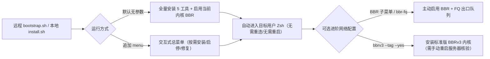

<div align="center">

# 🚀 ShellReady

**新服务器，一键配顺手。**

一条命令配好 Linux 服务器，集成 **BBR**、**trzsz-go**、**Starship**、**zsh-autosuggestions**、**Atuin** 和 **zoxide**，让每次 SSH 登录都更顺手。

<p align="center">
  
  
  
  
</p>

[核心功能](#功能) · [一条命令安装](#一条命令安装) · [菜单管理](#菜单安装与管理) · [环境范围](#环境范围) · [状态与卸载](#状态修复与卸载) · [BBR 与 BBRv3](#bbr-与可选-bbrv3) · [文件位置](#文件位置)

</div>

> [!IMPORTANT]
> **当前进度说明**：当前为首版实现，尚未发布正式版本。已提供远程一键入口、本地安装、六项功能总菜单、BBR 子菜单、单项工具管理、状态检查、卸载和可选 BBRv3 内核升级；Linux 整机安装、SSH 传输与内核启动仍需验收。测试记录见 [验证说明](docs/verification.md)。

---

<a id="功能"></a>

## ✨ 功能一览

| 组件 | 安装内容 | 日常使用 |
| :--- | :--- | :--- |
| 🌐 **[BBR](https://github.com/google/bbr)** | 启用当前内核的 BBR 并保存配置 | 默认不换内核、不要求重启 |
| 📂 **[trzsz-go](https://github.com/trzsz/trzsz-go)** | Go 版 `trz` / `tsz`（`1.2.0`） | `trz` 上传、`tsz` 下载 |
| ⚡ **[Starship](https://starship.rs/)** | Rust 版提示符，使用普通字符（`1.26.0`） | 显示用户、主机、目录、Git 与命令耗时 |
| 💡 **[zsh-autosuggestions](https://github.com/zsh-users/zsh-autosuggestions)** | Zsh 历史命令建议（`0.7.1`） | 输入前缀，按 `→`（右方向键）接受建议 |
| 🔍 **[Atuin](https://github.com/atuinsh/atuin)** | 本机命令历史与搜索（`18.22.0`） | `Ctrl+R` 搜索历史，保留原方向键行为 |
| 🚀 **[zoxide](https://github.com/ajeetdsouza/zoxide)** | 智能目录跳转（`0.10.0`） | 访问目录后，使用 `z 关键词` 跳转 |

- **Zsh 环境与配置**：包含 Zsh、补全和持久配置，默认将目标用户的登录 Shell 设置为 `/bin/zsh` 并核验结果。交互终端安装成功后自动以目标用户进入 Zsh，菜单安装则在退出总菜单后进入。权限不安全的补全目录会自动排除，其他终端功能继续加载。可以通过 `--keep-shell` 保留原登录 Shell 和当前会话，再手动运行 `zsh`。已有 Oh My Zsh 等配置会保留，但其快捷键和提示符可能与本项目配置互相覆盖，应在测试环境检查。
- **预编译免编译环境**：工具使用官方预编译程序，不要求服务器安装 Go 或 Rust。固定版本与 SHA-256 见 [产物清单](config/assets.tsv)：trzsz-go 1.2.0、Starship 1.26.0、zsh-autosuggestions 0.7.1、Atuin 18.22.0、zoxide 0.10.0。

### 🧭 核心工作流一览



---

<a id="一条命令安装"></a>

## ⚡ 一条命令安装

登录目标 Linux 服务器后，在 Bash 或 Zsh 中执行（需要已安装 `curl`）：

> [!NOTE]
> 公开下载入口已通过 `--help` 启动验证，完整 Linux 安装仍需按验证说明验收。

```bash
bash <(curl -fsSL https://raw.githubusercontent.com/9star-academy/ShellReady/main/bootstrap.sh)
```

入口会下载同一个 commit 的完整源码，再启动安装器，默认安装全部六个组件；不需要手动克隆仓库。这里使用 `bootstrap.sh`，因为 `install.sh` 需要仓库里的组件模块，不能单独下载执行。

只查看帮助，不安装：

```bash
bash <(curl -fsSL https://raw.githubusercontent.com/9star-academy/ShellReady/main/bootstrap.sh) --help
```

### 常用安装说明与参数

| 场景 / 特性 | 用法与行为说明 |
| :--- | :--- |
| **普通用户 / 指定用户** | 普通用户运行时会按需调用 `sudo`，为原用户配置。以 `root` 为其他用户安装时，在命令末尾加上 `--user ubuntu`（替换为实际用户名）。 |
| **保留 Shell / 跳过 BBR** | 可在命令末尾追加 `--keep-shell` 或 `--skip-bbr`。 |
| **自动进入 Zsh** | 交互终端安装成功后自动进入配置好的 Zsh，无需手动输入 `zsh` 或重新连接 SSH；默认无需重启服务器。后续通过 `shellready status` 查看状态。 |
| **默认 BBR 边界** | 默认安装只启用当前内核已有的 BBR。结束时会说明可选 BBRv3 的潜在收益与升级代价；需要升级的用户再单独执行命令，不会在一键安装中弹出选择菜单或自动更换内核。详见 [BBR 与可选 BBRv3](#bbr-与可选-bbrv3)。 |
| **固定源码版本** | 需要固定源码版本时，在命令前设置 `SHELLREADY_REF=<tag或commit>`；默认下载 `main` 当前指向的源码。下载失败时，引导脚本不会继续安装。 |

---

<a id="菜单安装与管理"></a>

## 🎛️ 菜单安装与管理

原来的一键安装命令保持不变：无参数直接安装全部六项。总菜单是额外入口，可以全部安装，也可以只安装需要的功能。

### 打开总菜单

- **本地完整源码目录执行**：
  ```bash
  bash install.sh menu
  ```
- **远程引导入口执行**（新版源码发布后）：
  ```bash
  bash <(curl -fsSL https://raw.githubusercontent.com/9star-academy/ShellReady/main/bootstrap.sh) menu
  ```
- **已安装后日常调用**：自动进入 Zsh 后，输入 `shellready` 或 `shellready menu` 打开总菜单。
  - 已有旧版安装时，用新版完整源码运行 `bash install.sh repair` 更新本地管理入口；它只修复已有组件，不补装已卸载的工具。
  - `shellready install` 继续直接全量安装。

```text
ShellReady 管理菜单
1. 一键安装全部功能
2. BBR 网络管理
3. 文件上传下载（trzsz-go）
4. 终端提示符（Starship）
5. 命令输入建议（zsh-autosuggestions）
6. 历史命令搜索（Atuin）
7. 常用目录跳转（zoxide）
8. 查看全部功能状态
9. 修复已安装功能
10. 卸载 ShellReady
11. 更新 ShellReady
0. 退出
```

### 单项组件管理与修复

五个终端工具分别提供**安装/修复、启用、停用和卸载**：
- **单项安装**：准备共享的 Zsh 环境，但不安装其他工具或修改 BBR；可传 `--keep-shell` 保持登录 Shell。
- **停用与卸载**：停用保留工具和数据；单项卸载保留配置、Atuin/zoxide 历史、其他组件与管理入口。重新连接 SSH 后验证终端变化。`trzsz` 停用仅移除本项目的 `trz`/`tsz` 入口，不移除系统中原有的同名工具。
- **状态保留规则**：停用标记在重装、修复和全量 `update` 后保留；重新安装已停用的工具后，如需启用，单独选择“启用”。`update` 仍按当前固定清单补齐全部工具，菜单中的“修复已安装功能”只处理已有组件。已有 FQ 管理记录会在全部状态检查和修复后一起检查，未完成时会报告待验证；修复不会自动重设出口队列，需从 BBR 子菜单主动处理。

也可通过命令行直接管理单项（内部名称为 `trzsz`、`starship`、`suggestions`、`atuin`、`zoxide`）：

```bash
shellready component atuin install
shellready component atuin status
shellready component atuin disable
shellready component atuin enable
shellready component atuin remove
shellready repair
```

### 在线更新（选项 11 / `self-update`）

总菜单选择 **11「更新 ShellReady」**，输入 `y` 确认后，会从本项目 `main` 下载同一 commit 的完整源码，更新管理入口并按新版清单修复已有组件：
- 不补装已卸载的工具，保留历史、配置和停用状态；固定跳过 BBR、内核及登录 Shell 变更，可能下载已有工具的新版本或系统依赖，并按需请求 `sudo`。
- 源码下载失败不会进入修复；修复阶段的失败会显示原因，不报告成功。
- 更新成功后退出旧菜单，再输入 `shellready` 打开新版；有跳过或待验证项时也退出旧菜单并提示检查结果。

也可直接执行命令：

```bash
shellready self-update
```

> [!TIP]
> - **命令区别**：`self-update` 获取项目新版；原来的 `update` 仍只使用本地固定清单全量安装/修复，`repair` 仍只修复已有组件。更新下载阶段不持有变更锁，只有新版安装器执行修复时加锁，避免嵌套锁冲突。
> - **旧版升级提示**：旧版没有选项 11 时，待含此功能的代码推送到 `main` 后，先用原安装账号执行一次下面的命令，之后即可从菜单更新：
>   ```bash
>   bash <(curl -fsSL https://raw.githubusercontent.com/9star-academy/ShellReady/main/bootstrap.sh) repair --skip-bbr --keep-shell
>   ```

<details>
<summary><b>📖 展开查看：菜单界面风格、按键交互、终端兼容与安全锁细节</b></summary>

- **B2 焦糖暖夜风格**：总菜单和 BBR 子菜单采用暖黄标题与分隔线、奶油白选中行、独立状态列。两个菜单的顶部信息区显示作者 `tangbaichuan` 和 GitHub 地址 [github.com/reedtang666](https://github.com/reedtang666)，位于系统/内核信息下方。作者名使用暖黄、地址使用奶油白；窗口较窄时分为两行展示。
- **按键与输入逻辑**：交互终端可输入数字或用 `↑/↓` 移动，按 `Enter` 执行；默认选中 `0`，直接 `Enter` 返回或退出，`Esc` 也可返回。数字输入时高亮即时更新，输入 `10` 后按 `Enter` 才进入卸载确认，不会在输入 `1` 时提前安装。方向键移动后再输入数字会重新选择，退格可修改输入；不支持的组合按键不会混入选项。过长输入只缩短显示，仍按完整输入判断，不截取为有效编号执行。
- **色彩与窗口尺寸自适应**：菜单按终端能力使用真彩色、256 色或普通 ANSI 近似色，颜色只作用于菜单区域，不更改终端主题设置。管道输出、`TERM=dumb` 或 `NO_COLOR=1 shellready` 使用无颜色数字菜单。方向键要求至少 64 列，总菜单至少 25 行、BBR 子菜单至少 24 行；更小窗口保留数字输入，避免重绘错位。窗口缩小时仍可退格修改已经输入的数字，仅更新输入行；放大后恢复方向键高亮。
- **状态恢复与只读安全**：菜单返回、退出、EOF、`Ctrl+C` 或 `SIGTERM` 会恢复进入读键前的终端输入模式，具体安装/卸载操作继续使用原有独立命令和确认规则。菜单读取本身不提权、不占安装锁、不安装依赖；执行具体变更时才按需调用 `sudo`。取消、输入结束或退出不会触发默认安装；操作失败会显示结果并返回菜单。
- **状态列核验说明**：状态列读取实际安装收据、工具入口和停用标记，区分已启用、已停用、未安装和待修复；“已启用”表示安装与启停记录正常，实际加载效果请在配置后的 Zsh 中验证。BBR 概览读取当前 TCP 算法、默认队列、运行内核及已加载模块版本；算法名 `bbr` 不等同于 BBRv3，默认队列也不等同于实际出口队列，详细核验仍选择“查看状态”。浏览和移动选中行不执行工具、不更改网络配置。

</details>

---

<a id="环境范围"></a>

## 🖥️ 环境范围

以下是安装器当前允许的范围，不等于已经完成各环境的实机认证。

| 项目 | 要求 |
| :--- | :--- |
| **系统** | Ubuntu 22.04 或 Ubuntu 24.04 及以上，Debian 12 及以上；可选内核升级不含 Ubuntu 22.04 |
| **架构** | `x86_64` / `ARM64`（`aarch64`） |
| **权限** | 安装和卸载需要 `root` 或 `sudo`；`status` 可由目标用户只读执行 |
| **网络** | 可访问发行版 apt 源、GitHub 及其下载域名 |
| **配置目录** | 标准 `HOME` 和 `.zshrc`；自定义 `ZDOTDIR` 或符号链接 `.zshrc` 会拒绝自动接入 |
| **容器** | 可用 `--skip-bbr` 测试工具；容器不支持本项目的内核升级 |

- **独立工具目录**：脚本使用独立目录保存工具，不替换系统中已有的同名程序。进入配置后的 Zsh 时，ShellReady 的工具目录优先于原 `PATH`。
- **版本识别与验证边界**：系统版本按 `/etc/os-release` 中的 `ID` 和数字 `VERSION_ID` 判断，不自动推断衍生发行版或缺少数字版本号的 testing/unstable 系统。较新版本通过最低版本检查不代表已完成实机验收。Ubuntu 26.04 可使用基础安装，也可主动选择 BBRv3 升级；内核升级还需满足下文的引导与回退条件。CI 容器矩阵覆盖 Ubuntu 22.04/24.04/26.04、Debian 12/13 的 x86_64 / ARM64 安装、重复安装和卸载检查；容器测试跳过 BBR，真实 SSH 交互与宿主内核 BBR 仍需在服务器验证。

---

<a id="本地安装"></a>

## 📦 本地安装

把完整仓库放到目标 Linux 服务器，在仓库目录执行：

```bash
bash install.sh
```

普通用户执行时会按需调用 `sudo`，并为原用户配置。以 `root` 为其他用户安装时，明确指定用户：

```bash
bash install.sh --user ubuntu
```

常用选项：

```bash
bash install.sh --keep-shell
bash install.sh --skip-bbr
bash install.sh --help
```

在交互终端中，安装、`update`、`repair` 或单项安装全部成功后会自动进入目标用户的 Zsh，无需重新连接 SSH。通过菜单安装/修复时，先继续使用菜单，退出总菜单后再自动进入。进入前会提示：

```text
正在进入 <用户名> 的 Zsh，无需重新连接 SSH。
输入 exit 会返回原来的终端；以后登录会自动使用 Zsh。
```

这是当前连接中新打开的 Zsh，输入 `exit` 后会提示已返回原来的终端。使用 `--keep-shell`、非终端输入输出、安装失败或部分跳过时不自动进入；使用 `--keep-shell` 时，需手动运行 `zsh` 才会加载增强功能。只读检查、卸载和菜单 11 在线更新也不会自动打开 Shell。默认 BBR 操作不要求重启整台服务器。

---

<a id="状态修复与卸载"></a>

## 🛠️ 状态、修复与卸载

安装并进入配置后的 Zsh 后，可使用本地命令（也可在完整仓库目录执行 `bash install.sh status`、`bash install.sh update`、`bash install.sh uninstall`）：

```bash
shellready                 # 总菜单
shellready status
shellready update
shellready uninstall
```

| 命令 | 功能说明 |
| :--- | :--- |
| `status` | 显示工具版本、核验 Shell 接入段内容、当前 BBR 和项目内核状态。交互和网络体验仍需实际验证。 |
| `update` | 按当前安装器携带的固定清单重新安装或补齐配置，不自动拉取上游 latest。升级清单需使用新版仓库或引导入口。 |
| `uninstall` | 移除本项目工具与 `.zshrc` 接入段；若登录 Shell 仍是项目设置的 `/bin/zsh` 或等价路径 `/usr/bin/zsh`，恢复原 Shell。保留历史数据、备份、系统依赖及内核。 |

### 恢复 BBR 配置与退出码

BBR 是全机设置，普通卸载保留它。需要恢复本项目安装前的 TCP 算法时，显式执行：

```bash
shellready uninstall --restore-bbr
```

如有其他用户正在使用该全机 BBR 配置，应先协调。配置或算法被后续操作修改时，恢复会停止并提示，避免覆盖新设置。已卸载本地命令后，可用仓库入口继续恢复。

- **退出码**：`0` 成功；`1` 失败；`2` 部分跳过或尚未就绪。工具下载失败时不接入不完整的 Shell 配置，修复后重跑即可继续。

---

<a id="bbr-与可选-bbrv3"></a>

## 🌐 BBR 与可选 BBRv3

### 三种网络配置模式对比

| 维度 | 1. 默认：当前内核 BBR | 2. 可选：启用 BBR + FQ | 3. 可选：安装指定 BBRv3 内核 |
| :--- | :--- | :--- | :--- |
| **触发方式** | 默认随一键安装自动执行 | `shellready bbr-fq --yes` 或子菜单 | `shellready bbrv3 --tag '<tag>' --yes` |
| **是否更换内核** | 否（使用现有内核 `tcp_bbr`） | 否 | **是**（安装标准版 `linux-image` 包） |
| **是否修改队列** | 否（保留现有网卡 `qdisc`） | **是**（修改默认路由出口队列为 `fq`） | 否（仅安装内核包） |
| **是否需要重启** | 否 | 否（可能短暂影响正在传输的数据） | **必须手动重启整台服务器后生效** |
| **系统要求** | Ubuntu 22.04 / 24.04+，Debian 12+ | 同左 + `iproute2`（`ip`/`tc`）、`jq` | **Ubuntu 24.04+、Debian 12+**（含 GRUB 回退检查） |

---

### 1. 默认：启用当前内核 BBR

检测并按需加载 `tcp_bbr`，启用已有能力，写入独立 sysctl 配置。不支持时明确跳过，不阻断其他工具；不更换内核，也不替换现有网卡 qdisc 或附加激进网络参数。

已有 sysctl 配置可能覆盖本项目设置时，会提示冲突文件并跳过，保留原配置。解决冲突后重跑即可。算法名为 `bbr` 本身不能证明是 v3，BBR 的实际收益取决于链路。

---

### 2. 是否需要升级 BBRv3

BBRv3 是 TCP 拥塞控制算法的版本，和 `uname -r` 显示的 Linux 内核版本不是同一个版本号。默认安装不会把当前 BBR 自动升级成 v3。

相比 BBRv1，BBRv3 的主要改进方向如下，效果需在实际业务链路验证：

| 方面 | 潜在收益 |
| :--- | :--- |
| **丢包与重传** | 更完善地利用丢包等拥塞信号调整发送量，减少拥塞造成的丢包与重传 |
| **延迟** | 改善排队控制和部分短请求延迟 |
| **带宽共享** | 改善与 CUBIC、Reno 等 TCP 连接共享瓶颈带宽的表现 |

> [!NOTE]
> - 这些收益不等于必然提速。Google 公布的部分部署结果中，BBRv3 的吞吐量与 v1 接近，改进主要体现在丢包、延迟和带宽共享。参考：[Google BBRv3 技术报告](https://datatracker.ietf.org/meeting/119/materials/slides-119-ccwg-bbrv3-overview-and-google-deployment-00)。
> - 网站、API、日常 SSH 等业务当前表现正常时，可继续使用现有内核 BBR。大文件分发、跨地区 TCP 传输或转发遇到吞吐不稳定、重传较多时，可先在具备回退条件的测试机上比较 v3。应在同一客户端、同一线路、相近时段对比吞吐、重传和传输时的延迟；升级不能突破云服务器购买的带宽上限。

安装提示为非交互说明，不改变成功/失败/跳过结果；当前内核不支持 BBR 时仍明确报告跳过，不会自动安装新内核。使用 `--skip-bbr`、安装存在失败项或执行 `update` 时，不展示首次安装的升级提示。

---

### 3. BBR 子菜单与可选 FQ

总菜单选择“BBR 网络管理”，或执行 `shellready bbr-menu`：

```text
1. 查看 BBR、内核和实际网卡队列
2. 启用当前内核 BBR
3. 启用 BBR + FQ（修改出口队列）
4. 选择标准版 BBRv3 内核安装
5. 恢复 ShellReady 修改的网络配置
6. 移除已记录的非运行 BBRv3 内核
0. 返回总菜单
```

默认全量安装仍只启用现有内核 BBR，保留原队列。FQ 必须主动选择并确认，需要系统提供 `ip`、`tc`（iproute2）和 `jq`；缺少时会提示，不在浏览菜单时安装系统包。独立命令如下：

```bash
shellready bbr-status
shellready bbr-enable
shellready bbr-fq --yes
shellready bbr-restore --yes
```

- **FQ 队列修改与保护边界**：FQ 操作会改变默认路由出口的实际队列，可能短暂影响正在传输的数据。只处理可识别的系统默认 `fq`、`fq_codel` 或默认参数的 `pfifo_fast` 队列；`mq` 保留为根队列，仅替换其支持的子队列。遇到自定义 handle、限速/整形、过滤规则、`noqueue` 或未知配置时整项跳过，不替换现有规则。运行前记录原默认值和队列参数，失败时尝试恢复，无法恢复时保留记录并明确报错。后续被其他操作修改的配置或队列不会强行覆盖。
- **持久化与恢复说明**：默认队列写入独立 sysctl 文件；这不等于所有网卡重启后一定使用 FQ，需重新运行 `bbr-status` 查看实际状态。恢复会处理本项目记录的队列与原 TCP 算法，不删除其他工具，不清空其他软件的网络配置，也不修改 TCP 缓冲区、带宽上限或附加区域调优。
- **内核列表筛选**：内核版本列表需要 `curl`、`jq`，按当前架构筛选最近 100 条发行记录中的标准正式版，过滤 Max/预发布/草稿；列表失败不会安装。选中版本后仍按下方流程核验，安装成功后需要自行安排服务器重启。

---

### 4. 可选：安装指定 BBRv3 内核

采用“先完成基础安装，再主动升级”的流程。独立入口使用 [byJoey/Actions-bbr-v3 Releases](https://github.com/byJoey/Actions-bbr-v3/releases) 的**标准版**内核包，要求明确指定 release tag。ShellReady 自行校验和安装发行包，不直接执行上游远程 `install.sh`，不附带其 Max 模式或其他网络调优。先检查系统、架构、容器环境、GRUB、当前内核回退文件、磁盘空间和 UEFI Secure Boot 状态。

- **前置要求**：系统最低要求为 **Ubuntu 24.04 及以上、Debian 12 及以上**，包括 Ubuntu 26.04。要求 `update-grub`、`grub-script-check`、`systemd-detect-virt`，当前内核和 initramfs 文件及匹配的 GRUB 启动项，以及 `/boot` 所在分区至少 1 GiB 可用空间。UEFI 环境还需 `mokutil`，且必须确认 Secure Boot 关闭。其他引导方式不自动处理。

基础安装完成并进入配置后的 Zsh 后，在 Releases 页面选择与服务器架构对应的标准 tag：`x86_64` 使用 `x86_64-X.Y.Z`，`ARM64` 使用 `arm64-X.Y.Z`，不带 `-max`。然后执行（占位符需要替换，不接受 `latest`）：

```bash
shellready bbrv3 --tag '<标准版 release tag>' --yes
```

本地仓库也可执行 `bash install.sh bbrv3 --tag '<标准版 release tag>' --yes`。`--tag` 与 `--yes` 缺一不可，默认 `install` / `update` 不会进入此流程。

该入口核验 GitHub API 提供的 SHA-256、内核包名、版本和架构，仅安装匹配的 `linux-image` 包，不安装 headers、libc-dev、Max 内核，不删除旧内核。上游产物结构不符合要求时会拒绝安装。

> [!WARNING]
> **重启与引导核验提醒**
> - 成功后显示“已安装，待重启验证”，退出码为 `2`。重启指**重启整台服务器**，会断开 SSH 并暂时中断业务；何时重启由用户决定，脚本不自动执行。重启前确认云厂商控制台或救援入口可用。
> - 重新连接后执行 `shellready update`，为新内核启用 BBR，再执行 `shellready status` 检查运行内核、已加载模块版本和拥塞控制算法。
> - 如果内核包已装好但引导更新中断，先修复提示的引导问题，再重跑同一条 `bbrv3` 命令补完检查；**未通过检查前不要重启**。

重启后可手动复核：

```bash
uname -r
cat /sys/module/tcp_bbr/version
sysctl net.ipv4.tcp_congestion_control
ss -tin
```

预期运行内核与选定 tag 对应，已加载模块版本为 `3`，默认算法为 `bbr`；在 TCP 传输时，对应连接详情应显示 `bbr`。仅有发行包安装成功或算法名 `bbr` 不足以证明已运行 v3。切换第三方内核后，需关注其安全更新，以及系统更新后实际启动的内核。

卸载由 ShellReady 记录的内核前，必须先启动其他可用内核：

```bash
shellready kernel-remove --tag '<已安装的标准版 release tag>' --yes
```

> [!CAUTION]
> 正在运行的内核会被拒绝卸载。此功能尚未完成真实服务器启动与回退验收，不应直接用于承载业务的服务器。

---

<a id="文件传输与本地历史"></a>

## 📂 文件传输与本地历史

- **trzsz 文件传输**：服务器端提供 `trz` / `tsz`。本地需要支持 trzsz 的终端，或使用 `tssh`、`trzsz ssh` 连接；仅安装服务器工具不会自动给普通 SSH 增加上传交互。详见 [trzsz-go 使用说明](https://github.com/trzsz/trzsz-go#usage)。
- **Atuin 本机历史**：Atuin 使用本项目独立配置，默认关闭自动同步、更新检查和 AI 快捷键，不自动注册、登录或上传历史。首次安装尝试导入目标用户已有的标准 Bash/Zsh 历史文件，成功后记录标记；当前仍在其他会话内、尚未写入历史文件的命令不会被导入。

---

<a id="文件位置"></a>

## 📁 文件位置

| 路径 | 内容 |
| :--- | :--- |
| `~/.local/share/shellready/` | 专属工具、管理命令、固定产物清单与配置 |
| `~/.local/share/shellready/config/starship.toml` | 可自行调整的提示符，重跑保留 |
| `~/.local/share/shellready/config/atuin/config.toml` | 本项目 Atuin 配置，重跑保留 |
| `~/.local/state/shellready/` | 原 Shell、导入标记和 `.zshrc` 备份，卸载保留 |
| `~/.zshrc` | 追加可识别的 ShellReady 接入段，其他内容保留 |
| `/etc/sysctl.d/90-shellready-bbr.conf` | 项目 BBR 持久配置 |
| `~/.local/share/shellready/config/disabled/` | 各工具独立停用标记 |
| `/var/lib/shellready/bbr/` | 全机 BBR 原状态与配置摘要 |
| `/etc/sysctl.d/90-shellready-fq.conf` | 主动启用 FQ 后的默认队列配置 |
| `/var/lib/shellready/qdisc/` | FQ 原状态、队列参数和恢复记录 |
| `/var/lib/shellready/kernels/` | 可选内核安装与验证记录 |

历史数据存放在各工具的数据目录中，不在 ShellReady 工具目录内；卸载不会删除它们。

---

<a id="开发与验证"></a>

## 🧪 开发与验证

```bash
python3 -m unittest discover -s tests -v
bash tests/check.sh
```

本地检查需要 Bash、Zsh、Python 3、jq 和 ShellCheck。测试目录 `tests/` 必须随代码一起提交，CI 会直接执行其中的脚本。`.github/workflows/ci.yml` 配置了两种架构、五个系统版本的容器安装测试；容器测试显式跳过 BBR，不代替真实内核、重启或 SSH 传输验证。

项目目标见 [agent.md](agent.md)，实现步骤见 [开发计划](docs/plans/2026-09-20-shellready-v0.1.md)，实际测试边界见 [验证记录](docs/verification.md)。

---

<a id="参考与致谢"></a>

## 🙏 参考与致谢

参考 [byJoey/Actions-bbr-v3](https://github.com/byJoey/Actions-bbr-v3) 的环境说明、版本选择、状态检查和卸载组织方式。ShellReady 独立实现管理逻辑，不直接执行上游安装脚本；可选内核功能使用其发行产物。

感谢 BBR、trzsz-go、Starship、zsh-autosuggestions、Atuin、zoxide 和 Zsh 的维护者。各上游组件遵循各自许可证；ShellReady 的项目许可证待维护者确定。
